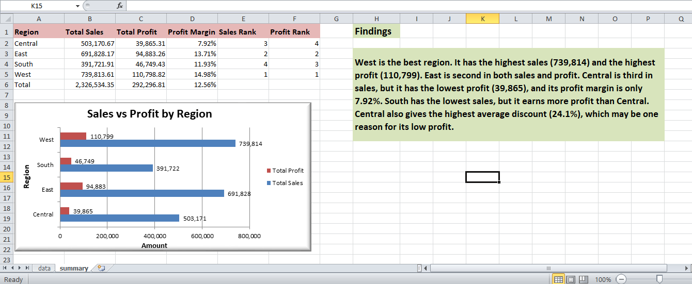

# Region Performance (Superstore Dataset)

## Overview
Compared sales and profit across the four regions in the Sample Superstore Orders data
(10,194 order lines) and ranked the regions, using Excel.

## Workbook structure
- data: original Orders data
- summary: region table, bar chart and findings

## Method
- SUMIFS: total sales and total profit per region
- Profit margin = total profit / total sales
- RANK: sales rank and profit rank
- Clustered bar chart: sales vs profit by region

## Results
| Region | Total Sales | Total Profit | Profit Margin | Sales Rank | Profit Rank |
|---|---|---|---|---|---|
| Central | 503,170.67 | 39,865.31 | 7.92% | 3 | 4 |
| East | 691,828.17 | 94,883.26 | 13.71% | 2 | 2 |
| South | 391,721.91 | 46,749.43 | 11.93% | 4 | 3 |
| West | 739,813.61 | 110,798.82 | 14.98% | 1 | 1 |
| Total | 2,326,534.35 | 292,296.81 | 12.56% | | |

## Findings
- West is first in both sales and profit
- Central is third in sales but last in profit, with a margin of only 7.92%
- Central also has the highest average discount (24.1%), which may be one reason

## Tools Used
Microsoft Excel (SUMIFS, RANK, bar chart)

## Dataset
Sample Superstore Dataset

## Screenshot

